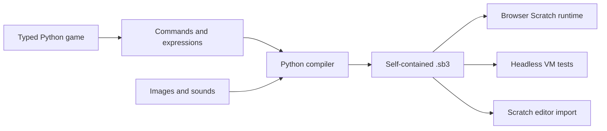

# Architecture

The generator and runtime communicate through a file format. Python can generate `.sb3` without being the language used to execute Scratch.

## Authoring layer

`itchy/game.py` defines typed dataclasses, reporter expressions, event builders, and block-generating functions. Commands describe work to perform later. Python lists name and compose sequences. `@action` constructs reusable descriptions at build time.

## Compiler

`itchy/compiler.py` creates per-sprite block graphs. `next` and `parent` link commands; `SUBSTACK` and `SUBSTACK2` link nested bodies. Reporters form input trees. Menu shadows identify keys, sprites, sounds, and broadcasts. Stage variables and messages use stable identifiers.

The compiler checks declared references, reads assets, and packages `project.json` with the referenced bytes. It embeds no Python or JavaScript application code in the Scratch export.

## Execution adapters

The browser player attaches rendering, bitmap, storage, and audio components to Scratch's VM. Headless tests attach storage and drive its scheduler directly through a JSON bridge. Bun is needed for setup, audio bundling, and current headless tests; the generated static preview runs with only a browser and an HTTP server.

## Initialization

Scratch event scripts run concurrently. The collectible example resets the player and score before broadcasting a `ready` message. The coin initializes and enters its collision loop only in response to that message. This prevents restart races between the player's previous position and the coin's reset state.
